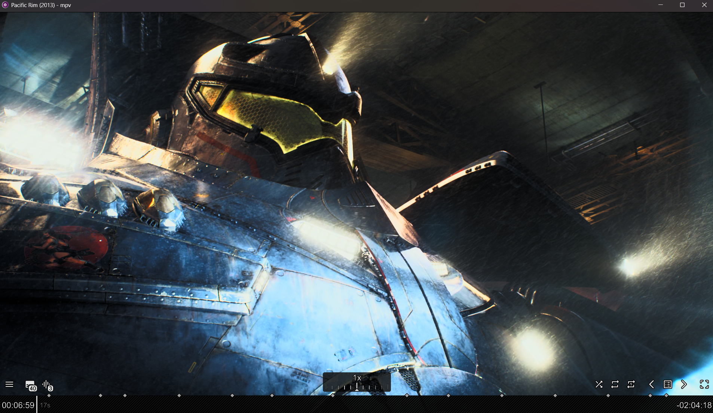

# mpv-config

My portable mpv config for Windows, mainly used through [plex-mpv-shim](https://github.com/iwalton3/plex-mpv-shim) to watch content from my Plex server on a home theater setup (4K display, AVR with surround sound).

## Screenshots

## Highlights

- **Clean default picture**: `profile=high-quality` on `gpu-next` with `d3d11` and `hwdec=auto-safe`. No shaders are loaded by default; upscaling shaders are opt-in per video via hotkeys or the menu.
- **Audio passthrough on by default**: AC3, E-AC3, DTS / DTS-HD and TrueHD are bitstreamed to the AVR so it decodes Dolby/DTS itself. If the output device does not accept a format (e.g. headphones), mpv falls back to decoding. `Alt+d` toggles passthrough off/on.
- **Modern UI**: [uosc](https://github.com/tomasklaen/uosc) replaces the built-in OSC, with a right-click / `Tab` menu built from `input.conf`.
- **Remembers where you left off**: `save-position-on-quit` plus a recent files list (memo).
- **Japanese audio, English subs** preferred by default.

## Layout

| Path | Purpose |
| --- | --- |
| `portable_config/mpv.conf` | Main settings (video, audio, subs, screenshots, cache) |
| `portable_config/profiles.conf` | Shader presets, auto profiles and the stereo downmix profile |
| `portable_config/input.conf` | Hotkeys and the uosc menu definition |
| `portable_config/scripts/` | Lua scripts (see below) |
| `portable_config/script-opts/` | Script settings |
| `portable_config/shaders/` | ArtCNN, Ani4Kv2, FSRCNNX, Anime4K and CfL chroma shaders |

## Setup

1. Put the `portable_config` folder next to `mpv.exe` (mpv picks it up automatically as a portable config).
2. Point plex-mpv-shim at that mpv (see below).
3. Optional: put `yt-dlp.exe` next to `mpv.exe` for YouTube/URL playback.
4. Adjust machine-specific paths in `mpv.conf` (`screenshot-dir`) and `scripts/webm.lua` (output directory) if needed.

## plex-mpv-shim

By default the shim runs its own bundled mpv with its own `mpv.conf` / `input.conf`. These settings in the shim's `conf.json` (`%APPDATA%\plex-mpv-shim\conf.json`) make it launch this mpv instead:

| Setting | Value | Why |
| --- | --- | --- |
| `mpv_ext` | `true` | Use an external mpv instead of the bundled one |
| `mpv_ext_path` | `C:\\Program Files (x86)\\mpv\\mpv.exe` | The mpv that has `portable_config` next to it |
| `mpv_ext_start` | `true` | The shim launches mpv itself |
| `mpv_ext_no_ovr` | `true` | Don't load the shim's `mpv.conf` / `input.conf`, so this config is used as-is |
| `enable_osc` | `false` | The shim sets `osc` on startup even with `mpv_ext_no_ovr`; keep it off for uosc |
| `audio_ac3passthrough` / `audio_dtspassthrough` | `true` | Only affects transcodes: lets Plex keep AC3/E-AC3/DTS audio instead of converting it to AAC. Direct play passthrough is handled by `audio-spdif` in `mpv.conf` |

### Shim key overrides

The shim binds its own keys at runtime (`kb_*` settings), and these replace the `input.conf` bindings for the same keys while playing from Plex:

| Key | Shim action | Replaces |
| --- | --- | --- |
| `Left` / `Right` | Seek -5s / +5s (`Right` also skips the intro when inside one) | evafast hold-to-fast-forward |
| `Up` / `Down` | Seek +10s / -10s (`Up` also skips the intro when inside one) | Volume +/-5 (use the mouse wheel or `Ctrl+Up` / `Ctrl+Down`) |
| `Space` | Play / pause (or select in the shim menu) | Same as before |
| `Enter` | Select in the shim menu | Play / pause |
| `Esc` | Back in the shim menu, otherwise exit fullscreen | mpv default |
| `q` | Stop playback and report to Plex | Disabled quit |
| `c` | Shim menu (quality, transcode, subtitle settings) | |
| `<` / `>` | Previous / next item in the play queue | |
| `w` | Mark watched and skip to next | |
| `u` | Mark unwatched and stop | |

Setting a `kb_*` value to `null` in `conf.json` removes that shim binding so the `input.conf` one applies again.

## Audio

| Setting | Value | Notes |
| --- | --- | --- |
| `audio-spdif` | `ac3,eac3,dts-hd,truehd` | Passthrough formats (`dts-hd` covers plain DTS too) |
| `audio-channels` | `auto-safe` | Decoded audio uses the device's channel layout |
| `audio-exclusive` | `no` | WASAPI switches to exclusive on its own during passthrough |

When watching on TV speakers or headphones, the **Audio > Downmix > Stereo + dialogue boost** menu entry applies a 5.1/7.1 to stereo downmix with a louder center channel. Passthrough has to be off (`Alt+d`) for the downmix filter to apply.

`Alt+a` shows the current codec, input/output channel count, sample rate and output device, which is handy to confirm whether audio is being bitstreamed or decoded.

## Shader presets

Default playback uses only `profile=high-quality`. Presets are defined in `profiles.conf` and every preset also loads `CfL_Prediction` for chroma upscaling. Use `i` (stats) to check GPU frame times after switching.

| Key | Preset | Use for |
| --- | --- | --- |
| `Ctrl+1` | Ani4Kv2 ArtCNN | Anime 720p/1080p to 4K |
| `Ctrl+2` | AniSD ArtCNN | Anime SD/DVD |
| `Ctrl+3` | ArtCNN C4F16 | Anime, lighter GPU load |
| `Ctrl+4` | FSRCNNX 16 | Live action |
| `Ctrl+5` | FSRCNNX anime_enhance | Anime, also cleans compression |
| `Ctrl+6` | Anime4K Mode A | Blurry/compressed anime |
| `Ctrl+7` | Anime4K Mode B | Softer restore, fewer artifacts |
| `Ctrl+8` | Anime4K Mode C | Clean anime sources |
| `Ctrl+0` | Off | Back to high-quality only |

`Shift+Tab` opens the shader submenu directly.

## Hotkeys

Most actions are also available from the right-click / `Tab` menu.

### Playback

| Key | Action |
| --- | --- |
| `Space` / `Enter` | Play / pause |
| Double click | Fullscreen |
| `Right` | Seek +5s (hold to fast-forward, evafast) |
| `Left` | Seek -5s |
| `Alt+Right` / `Alt+Left` | Seek +/-10s (exact) |
| `Ctrl+Right` / `Ctrl+Left` | Seek +/-60s |
| `Shift+Right` / `Shift+Left` | Next / previous frame |
| `n` / `p` | Next / previous in playlist |
| `r` | Recent files (memo) |
| `q` / `Q` | Disabled to avoid accidental quits |

### Audio

| Key | Action |
| --- | --- |
| `Alt+d` | Toggle passthrough / decode |
| `Alt+a` | Show audio output info |
| `Up` / `Down` / mouse wheel | Volume +/-5 |
| `m` | Mute |
| `b` | Audio track menu |
| `j` / `k` | Audio delay -/+100ms |
| `Ctrl+j` | Reset audio delay |

### Subtitles

| Key | Action |
| --- | --- |
| `v` / `V` | Next / previous subtitle track |
| `g` / `h` | Subtitle delay -/+100ms |
| `Ctrl+g` | Reset subtitle delay |
| `=` / `-` | Bigger / smaller |
| `+` / `_` | Move down / up |
| `Ctrl+s` | Force my subtitle style on ASS subs (toggle) |

### Video

| Key | Action |
| --- | --- |
| `Ctrl+i` | Toggle interpolation (auto-switches `video-sync=display-resample`) |
| `Ctrl+d` | Detect and toggle deinterlacing (autodeint) |
| `o` | Toggle unscaled |
| `a` | Cycle aspect ratio (16:9, 4:3, 2.35:1, original) |
| `~` | Always on top |

### Tools

| Key | Action |
| --- | --- |
| `i` | Stats overlay (GPU frame times) |
| `t` | Show progress |
| `T` | Cycle OSD level |
| `S` | Screenshot with subtitles |
| `s` | Screenshot without subtitles |
| `Ctrl+c` | Copy current timestamp to clipboard |
| `Ctrl+v` | Open URL from clipboard |
| `W` | WebM/clip encoder |

## Scripts

| Script | Purpose |
| --- | --- |
| [uosc](https://github.com/tomasklaen/uosc) | UI, menus, timeline |
| [thumbfast](https://github.com/po5/thumbfast) | Timeline thumbnails |
| [memo](https://github.com/po5/memo) | Recent files history |
| [evafast](https://github.com/po5/evafast) | Hold-to-fast-forward on `Right` |
| autoload | Loads neighboring files into the playlist |
| autodeint | Deinterlace detection |
| fuzzydir | Lets `sub-file-paths` search subfolders |
| copyTime | Copy timestamp to clipboard |
| copy-paste-URL | Open a URL from the clipboard |
| [webm](https://github.com/ekisu/mpv-webm) | Cut and encode clips |
